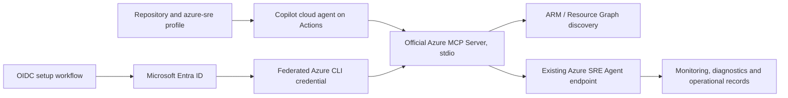

# Azure SRE agent setup

`azure-sre` is a native GitHub Copilot custom agent for **Actions-backed cloud-agent
sessions on GitHub.com**. It runs Microsoft's Azure MCP Server as a local stdio
process, delegates investigations to an existing Azure SRE Agent, and correlates
returned evidence with repository code and history. There is no custom server or
hosted intermediary.

The integration uses a pinned **preview** package, `@azure/mcp@4.0.0-beta.9`.
Local configuration checks and real MCP initialization/discovery passed.
Azure authentication, authorization, operational investigations, and GitHub.com
agent discovery have **not** been live-tested. Complete the acceptance checklist
before production use. Read [security](azure-sre-agent-security.md), especially
the accepted direct-mutation approval gap.

## Architecture and supported environments



| Host | Support and configuration |
| --- | --- |
| GitHub.com, Actions-backed cloud agent | Selected implementation. Issue assignment and continuation on its PR use the agent profile and setup workflow. Choose **Actions** when an environment selector is offered. |
| GitHub.com, Cloud sandbox | Not supported by this secretless setup. GitHub explicitly excludes setup-step OIDC login from Cloud sandboxes. Start a new Actions session instead. |
| Local Copilot CLI | Native custom agents and local MCP are supported; authenticate locally with an approved identity. See local setup below. Does not use the Actions workflow. |
| VS Code Agent Mode | Azure MCP is supported, but agent-profile `mcp-servers` is ignored and `target: github-copilot` excludes this profile. Use separately registered MCP and the documented profile adaptation below. |
| Remote HTTP/SSE MCP | GitHub supports these transports, but not remote MCP OAuth in this configuration path. This solution neither deploys a remote Azure MCP server nor assumes a public SRE MCP URL. |

GitHub supports MCP **tools**, not server resources or prompts. `sreagent_*` are
Azure MCP tools; common-prompt reading is a tool operation, not MCP prompt support.
Azure resolves `Microsoft.App/agents` endpoints through Resource Graph. Don't
hardcode endpoint URLs or confuse this integration with connectors that SRE Agent
uses to call other services.

## Prerequisites

An Azure administrator needs an existing, provisioned Azure SRE Agent resource,
its subscription/resource group, approved telemetry connectors and managed
resources, and permission to configure an identity, federation and scoped role
assignments. Provisioning the SRE resource is outside this repository's workflow.
See [SRE Agent documentation](https://learn.microsoft.com/en-us/azure/sre-agent/).

A GitHub administrator needs Copilot cloud agent enabled for the repository,
GitHub Actions permitted, permission to manage Agents variables and the `copilot`
environment, and permission to merge the agent and setup workflow into the default
branch. Workflow/agent updates should receive security review and branch protection.
No general-purpose deployment credential or GitHub PAT is needed.

The runtime needs Node.js 22+, npm/npx, Azure CLI with OIDC support, and outbound
HTTPS to the npm registry/package artifacts, Microsoft Entra, ARM/Resource Graph,
and the **discovered** SRE endpoint. The workflow installs Node.js 22 and assumes
Azure CLI on the standard Ubuntu runner. Custom runners must supply it.

## Identity and minimum permissions

There are two separate identities:

| Identity | Required scope and purpose |
| --- | --- |
| Copilot caller UAMI | A dedicated user-assigned managed identity, trusted through GitHub OIDC. Reader on the selected SRE resource for control-plane discovery; resource-group scope only when agreed group-wide discovery is needed. SRE data-plane role on each selected `Microsoft.App/agents` resource. |
| Existing Azure SRE Agent identity | Independently configured telemetry/resource/connector access. It must not gain production write permissions merely because Copilot can start an investigation. Audit existing and inherited roles, response plans, tasks, policies and hooks. |

The [MCP article](https://learn.microsoft.com/en-us/azure/sre-agent/mcp-server)
documents **SRE Agent Administrator** for data-plane operations. The newer
[user-role reference](https://learn.microsoft.com/en-us/azure/sre-agent/user-roles)
documents **SRE Agent Standard User** for chat/diagnostics, memory uploads and
scheduled tasks, while reserving approvals for Administrator. Start by evaluating
Reader plus Standard User at the selected agent scope in nonproduction.
This combination's compatibility with all exposed MCP operations and an
application identity is **not live-verified**. Check actual role definitions and
test each permitted operation. If it fails, document the missing data action and
have an administrator decide the smallest supported assignment; do not
automatically grant Administrator, Author, Contributor or Owner.

For historical read-only access without starting investigations, evaluate SRE
Agent Reader. Azure Owner/Contributor does not substitute for SRE data-plane
roles. Role assignments themselves require an appropriately authorized
administrator, not the Copilot caller.

An administrator can review this candidate assignment before applying it:

```shell
az role assignment create \
  --assignee-object-id "$CALLER_PRINCIPAL_ID" \
  --assignee-principal-type ServicePrincipal \
  --role Reader \
  --scope "$SRE_AGENT_RESOURCE_ID"

az role assignment create \
  --assignee-object-id "$CALLER_PRINCIPAL_ID" \
  --assignee-principal-type ServicePrincipal \
  --role "SRE Agent Standard User" \
  --scope "$SRE_AGENT_RESOURCE_ID"
```

These are proposed administrator operations, not setup-workflow steps.
`CALLER_PRINCIPAL_ID` is the dedicated caller UAMI's principal ID;
`SRE_AGENT_RESOURCE_ID` is the complete ARM ID of the selected existing agent.
Keep resource scope for the initial test. If Resource Graph discovery requires
an agreed resource-group scope, have the administrator review that change
separately rather than broadening to the subscription.

## Administrator configuration

### 1. Review effective SRE access

Use an approved nonproduction agent for initial testing. Confirm telemetry access,
the existing SRE identity's roles, Review mode where applicable, and administrator
approval ownership. See the [security checklist](azure-sre-agent-security.md#administrator-security-checklist).
Reader-level provisioning can still assign Monitoring Contributor and other roles;
its label is not a proof that all writes are impossible.

### 2. Configure federated identity

Microsoft's official automation is:

```shell
azd extension install azure.coding-agent
azd coding-agent config
```

Run it only as an administrator after reviewing the changes. It creates/reuses a
resource group and UAMI, assigns Reader at resource-group scope, creates a federated
credential, updates GitHub configuration, and creates a workflow branch/PR.
Review its generated workflow rather than overwriting this repository's setup file.
Tighten the default Reader scope if appropriate. Do not copy its broad MCP `*`
example into this agent.

The command remains `azd coding-agent config`; Microsoft's
[dedicated guide](https://learn.microsoft.com/en-us/azure/developer/azure-mcp-server/how-to/github-copilot-cloud-agent)
explicitly confirms that identifier even where GitHub docs use newer UI wording.

Verify the **actual** OIDC subject before relying on generated federation:

| Claim | Required value |
| --- | --- |
| Issuer | `https://token.actions.githubusercontent.com` |
| Audience | `api://AzureADTokenExchange` |
| Subject | The exact GitHub-emitted subject for this repository and `copilot` environment, including immutable owner/repository IDs or custom subject claims when enabled. |

The extension source consulted still constructs
`repo:<owner>/<repo>:environment:copilot`. GitHub repositories created, renamed or
transferred after July 15, 2026 may instead emit
`repo:<owner>@<owner_id>/<repo>@<repo_id>:environment:copilot`.
Use GitHub's OIDC settings/subject preview and the
[immutable-subject guidance](https://learn.microsoft.com/en-us/entra/workload-id/workload-identities-github-immutable-subjects);
don't guess IDs, enable mutable subjects to work around failure, or print OIDC
tokens. Match custom organization claims if present.

For manual configuration, create or select a dedicated UAMI and create its
federated credential through Azure's supported IAM/identity workflow with the
verified claims. An administrator can use:

```shell
az identity federated-credential create \
  --name copilot-sre \
  --identity-name "$IDENTITY_NAME" \
  --resource-group "$IDENTITY_RESOURCE_GROUP" \
  --issuer https://token.actions.githubusercontent.com \
  --subject "$COPILOT_OIDC_SUBJECT" \
  --audiences api://AzureADTokenExchange
```

These shell placeholders are administrator inputs, not required MCP environment
variables. Review the identity and role-assignment plan before executing it.
Don't add wildcard repository/branch trusts.

### 3. Set GitHub configuration

Create the `copilot` environment for the OIDC environment subject as required by
the official setup. In the current GitHub UI, manage the following non-sensitive
values under **Settings > Secrets and variables > Agents > Variables**:

| Name | Requirement | Consumer |
| --- | --- | --- |
| `AZURE_CLIENT_ID` | Required UAMI client ID, not principal/object ID | Federated login |
| `AZURE_TENANT_ID` | Required tenant ID | Federated login |
| `AZURE_SUBSCRIPTION_ID` | Required default subscription ID | Login and Azure CLI's default subscription |
| `AZURE_TOKEN_CREDENTIALS` | Literal `AzureCliCredential`, already in profile | MCP credential selection |
| Resource group / SRE agent name | Prompt inputs, or dynamically discovered | MCP `resource-group` and `agent` parameters |

No client secret, certificate, access token, `AZURE_FEDERATED_TOKEN_FILE`, or
`COPILOT_MCP_*` secret is required by this setup. An ordinary GitHub-hosted runner
doesn't expose the Azure managed-identity metadata endpoint: use federated
`azure/login`, not `auth-type: IDENTITY`.

GitHub documents migration from old `copilot` environment secrets/variables to
Agents settings. Only Agents values are passed into actual Copilot sessions;
ordinary Actions secrets are not a substitute. The committed workflow follows
Microsoft's `vars.*` login template. When testing with ordinary
`workflow_dispatch`, also make the same three non-secret values available as
Actions variables in the `copilot` environment; ordinary Actions runs don't
automatically receive Agents variables. Confirm the effective values in the
actual Copilot setup logs without dumping the environment.

### 4. Merge and select

Merge the profile and `.github/workflows/copilot-setup-steps.yml` into the default
branch through the usual review process. GitHub runs setup steps only once that
file is on the default branch. The workflow uses only `workflow_dispatch` for
ordinary manual tests, not untrusted PR/push triggers. Copilot still invokes its
reserved setup job when starting Actions-backed tasks.

The setup performs noninteractive OIDC login and checks acquisition for ARM and
the SRE data-plane audience used by the official server
(`59f0a04a-b322-4310-adc9-39ac41e9631e`). Token contents aren't printed. This checks
credential acquisition, **not** authorization to an agent.
Azure CLI and the MCP server obtain tokens for the relevant audience as needed.
Token/assertion lifetimes are limited; don't assume a one-time OIDC assertion can
renew forever. On expiration, start a fresh configured Actions session and resume
the recorded investigation thread.

No repository-wide MCP setting is required: the agent's frontmatter owns the
`azure-sre-mcp` local server. There is no `.mcp.json` file that automatically
configures GitHub.com's repository settings. If administrators require shared MCP
instead, transfer this profile's server object to JSON under `mcpServers` in
**Settings > Copilot > MCP servers**, preserve the exact arguments/tool lists,
and remove the duplicate agent-specific server declaration after review. Settings
override profile servers with the same name. Review effects on other agents and
Copilot code review; a shared server is not restricted to this profile.

At [GitHub's agents page](https://github.com/copilot/agents), select the repository,
branch and **azure-sre**, and select Actions where offered. For an issue, use
**Assign to Copilot** and select this custom agent. Continue in the resulting PR's
Copilot session; GitHub retains its agent-profile version. Analysis-only issue
assignments may still create a task PR automatically; the profile does not
authorize file changes unless requested. `disable-model-invocation: true` makes
selection explicit rather than automatic.

## Complete discovered tool inventory

Real MCP `initialize` and complete `tools/list` on the pinned package returned
**55 SRE tools**. The configured process exposed exactly **22**. All required
parameter names below are from that response, not inferred from CLI spelling.
Most agent-bound tools also accept `tenant`, `subscription` and `resource-group`.
Full optional parameters, schemas and annotations can be retrieved without Azure
operations using `npm run --silent inventory:mcp`.

Access: **Read** = exposed read tool; **Thread** = exposed investigation write;
**Approval** = exposed direct mutation with instruction-only approval;
**Excluded** = not exposed. Read-only annotations are hints, not an RBAC boundary.

| Exact tool name | Required parameters | Access |
| --- | --- | --- |
| `sreagent_agents_create` | name, agent | Excluded |
| `sreagent_agents_delete` | name, agent | Excluded |
| `sreagent_agents_get` | agent | Read |
| `sreagent_agents_list` | none | Read |
| `sreagent_agents_tools_create` | name, tool-type, agent | Excluded |
| `sreagent_agents_tools_get` | name, agent | Excluded |
| `sreagent_agents_tools_list` | agent | Excluded |
| `sreagent_architecture_plan` | requirements | Excluded |
| `sreagent_commonprompts_create` | name, content, agent | Excluded |
| `sreagent_commonprompts_delete` | name, agent | Excluded |
| `sreagent_commonprompts_get` | name, agent | Read |
| `sreagent_commonprompts_list` | agent | Read |
| `sreagent_connectors_create_kusto` | name, cluster-url, agent | Excluded |
| `sreagent_connectors_create_mcp` | name, type, agent | Excluded |
| `sreagent_connectors_delete` | name, agent | Excluded |
| `sreagent_connectors_get` | name, agent | Excluded |
| `sreagent_connectors_list` | agent | Excluded |
| `sreagent_connectors_test` | name, agent | Excluded |
| `sreagent_docs_get` | topic | Read |
| `sreagent_docs_memories_add` | name, content, agent | Approval |
| `sreagent_docs_memories_delete` | name, agent | Excluded |
| `sreagent_docs_memories_list` | agent | Read |
| `sreagent_docs_memories_reindex` | agent | Excluded |
| `sreagent_docs_memories_search` | query, agent | Read |
| `sreagent_hooks_delete` | name, agent | Excluded |
| `sreagent_hooks_get` | name, agent | Excluded |
| `sreagent_hooks_list` | agent | Excluded |
| `sreagent_hooks_thread_activate` | thread-id, hook-name, agent | Excluded |
| `sreagent_hooks_thread_deactivate` | thread-id, hook-name, agent | Excluded |
| `sreagent_hooks_thread_list` | thread-id, agent | Excluded |
| `sreagent_incidents_active_list` | agent | Read |
| `sreagent_incidents_create` | severity, title, description, services, agent | Approval |
| `sreagent_incidents_plans_create` | name, severity, trigger-condition, services, steps, agent | Excluded |
| `sreagent_incidents_plans_list` | agent | Read |
| `sreagent_incidents_setup_pagerduty` | name, api-key-env, agent | Excluded |
| `sreagent_incidents_setup_servicenow` | name, instance-url, auth-type, agent | Excluded |
| `sreagent_scheduledtasks_create` | name, cron-expression, message, agent | Approval; nonproduction only |
| `sreagent_scheduledtasks_delete` | task-id, agent | Approval; explicit confirm also required |
| `sreagent_scheduledtasks_get` | task-id, agent | Read |
| `sreagent_scheduledtasks_list` | agent | Read |
| `sreagent_scheduledtasks_pause` | task-id, agent | Approval |
| `sreagent_scheduledtasks_resume` | task-id, agent | Approval; effective settings must be verified |
| `sreagent_skills_create` | name, content, agent | Excluded |
| `sreagent_skills_delete` | name, agent | Excluded |
| `sreagent_skills_list` | agent | Excluded |
| `sreagent_threads_create` | message, agent | Thread |
| `sreagent_threads_delete` | thread-id, agent | Excluded |
| `sreagent_threads_get` | thread-id, agent | Read |
| `sreagent_threads_investigate` | message, agent | Thread |
| `sreagent_threads_investigate_yolo` | message, agent | Always excluded |
| `sreagent_threads_list` | agent | Read |
| `sreagent_threads_send_message` | thread-id, message, agent | Thread |
| `sreagent_workflows_apply` | yaml-content, agent | Excluded |
| `sreagent_workflows_generate` | kind, name, description | Excluded |
| `sreagent_workflows_validate` | yaml-content | Excluded |

Destructive tools can require the optional `confirm` property at execution despite
it not appearing in the schema's required array. Never infer safety from that
array. No incident state-update tool exists in this inventory. Plan creation and
workflow deployment are excluded as unnecessary privileges.

`--tool` exposes individual tools and avoids the default namespace dispatcher,
which would undermine a per-tool allowlist. `--disable-proxy-tools` disables
unrelated registry-proxied tools. A blanket `--read-only` would remove required
thread operations and cannot implement this investigation workflow.

## Connection tests and local validation

```shell
npm ci --ignore-scripts
npm test
npm run validate
npm run validate:mcp
npm run --silent inventory:mcp
```

The last two commands start bounded local official MCP processes, perform
initialization and tool discovery, then close them. They never call an Azure
tool or use live Azure access. The inventory command intentionally discovers
the full SRE namespace, including excluded tools, **only for inspection**;
the production profile never exposes that dispatcher/full set.
The lockfile pins validation dependencies; cloud `npx` pins the server version
but still downloads its distribution and transitive runtime dependencies.

| Test | Local result / remaining integration evidence |
| --- | --- |
| 1. Discovery | Profile parsed and validated; GitHub.com dropdown, issue selection and PR version continuity not tested. |
| 2. Initialization | Passed: real server 4.0.0-beta.9, 55 inventory tools, exactly 22 filtered tools. Actions startup logs not tested. |
| 3. Authentication | Preflight missing/present-variable tests passed; actual GitHub OIDC, both token audiences and SRE authorization not tested. |
| 4. Agent discovery | Not tested against Azure. In a configured Actions session ask to list agents only; verify resource scope and ambiguity handling. |
| 5. Investigation | Not tested. Explicitly authorize a nonproduction investigation, verify standard mode and retain its thread ID. |
| 6. Results | Not tested. Read/resume that thread and check every finding against returned records. |
| 7. Correlation | Not tested against real incidents. Adopt in a repository with application/IaC and link evidence to real deployment commits. This repository started empty. |
| 8. Boundaries | Passed local checks rejecting YOLO, wildcard/extra tools, dangerous flags and extra workflow privileges. Live RBAC and SRE gates not tested; direct mutation approval is not technically enforced. |
| 9. Failures | Passed local tests for pagination, protocol errors, timeout propagation and malformed/missing tools. Actual expired tokens, unavailable agents and approval behavior not tested. |
| 10. PR | Not tested on GitHub.com. Explicitly request a focused fix in an application repository, review checks/PR, verify no deployment or merge. |

In an actual session, inspect **Start MCP Servers** logs and the setup job. First
prompt: "Using azure-sre, list accessible SRE Agents in the configured subscription.
Do not start an investigation or modify any repository or Azure content."
Then select one nonproduction target and use an [example](azure-sre-agent-examples.md).
Record executed tests, target, package/profile commit, thread IDs, and sanitized
results. Do not label a successful token-acquisition check as a passed investigation.

### First-time administrator checklist

- Confirm Actions-backed Copilot and protected profile/workflow changes.
- Confirm an existing nonproduction SRE resource, telemetry and authorized approver.
- Review both identities' effective roles and SRE run modes/policy/hook overrides.
- Configure exact UAMI federation claims, including immutable subject format.
- Set the three Agents variables; check standalone Actions test variables separately.
- Review Reader/Standard User permissions and the MCP Administrator discrepancy.
- Merge the files to the default branch and check repository MCP override collisions.
- Validate startup, OIDC token audiences, agent discovery and thread results.
- Run safe nonproduction denial/approval/timeout tests; never probe production writes.
- Obtain security acceptance for exposed direct mutations or remove them from all
  three profile allowlists and the validator's reviewed tool set.
- Complete real repository correlation and requested PR tests before rollout.

## Troubleshooting

| Symptom | Check and action |
| --- | --- |
| Agent absent | Default-branch merge, correct repository/branch, Copilot availability, explicit selection and frontmatter. Unrecognized tool names can be silently ignored by GitHub. |
| Missing configuration | Agents variables for actual Copilot tasks; Actions environment variables for ordinary manual dispatch. Don't log their values. |
| No Azure CLI credential | Confirm **Actions**, successful setup, CLI availability and login cache. Cloud sandbox does not run this workflow. Restart a configured Actions session. |
| Federation mismatch | Compare actual issuer/audience/subject with the UAMI credential, especially immutable IDs and the `copilot` environment. Don't broaden trust to bypass it. |
| ARM works; SRE returns 401/403 | Check SRE-audience token acquisition and resource-scoped SRE data role independently from Reader. Document the role discrepancy; do not silently elevate. |
| No agents / ambiguous agents | Check subscription, resource-group scope, provisioning and role propagation; choose explicitly rather than treating an empty result as an outage. |
| Tools missing / MCP fails | Node 22+, pinned package, startup stderr via approved sanitized diagnostics, exact `--tool` names, settings overrides and network reachability. Never use `*` as recovery. |
| Approval or authorization pending | Preserve thread ID; an authorized Azure human resolves it. Don't pass approval text or switch to YOLO. |
| Timeout / interrupted write | Inspect existing state and messages before retrying. Server work may continue. Report partial findings and unknown outcomes. |
| Expired token/assertion | Start a fresh OIDC-backed Actions session, rediscover the same agent and resume the thread. No interactive login or hardcoded token. |
| Production schedule requested | MCP task-create has no run-mode option. Administrator must configure Review in Azure; the profile refuses production creation through this tool. |
| Schedule cannot be verified | Leave paused when payload/scope/effective approval mode cannot be verified; use administrator review. |

Default investigation-loop limits are 20 follow-ups and 600 seconds. Create/get/
message calls are preferable for resumable work. GitHub's effective MCP call
timeout was not verified; do not assume it matches Azure's limit or retry
non-idempotent writes automatically.

## Local clients

For local CLI, authenticate with an approved identity via `az login`, select the
intended subscription, and select the custom agent with `/agent`. Microsoft's
[SRE MCP guide](https://learn.microsoft.com/en-us/azure/sre-agent/mcp-server) also
documents CLI `/mcp add` or `~/.copilot/mcp.json`. If your CLI version needs separate
registration, use `mcpServers` with the exact server object from this profile and
avoid duplicate names. Local interactive login is a local-only setup, never a
requirement of cloud execution. Cloud GitHub variable substitutions aren't local
shell substitutions.

For VS Code, register Azure MCP using its official extension or `.vscode/mcp.json`
(`servers` root and `type: stdio`), copy the same startup arguments, and authenticate
locally. For a local-only adapted agent, change/remove `target`, remove the ignored
`mcp-servers` block, and select actual VS Code runtime tool names after discovery.
Don't assume cloud server-qualified aliases match IDE names. This repository
doesn't commit that duplicated profile or machine-specific configuration.

## Sources and maintenance

Consulted November 23, 2026. Revalidate package flags, inventory and authentication
on every upgrade; changing allowed tools requires security review and updating
all three profile lists plus the validator. Keep test status tied to executed
evidence.

- [SRE MCP](https://learn.microsoft.com/en-us/azure/sre-agent/mcp-server)
  ([requested overview](https://learn.microsoft.com/en-us/azure/sre-agent/mcp-server-overview)
  redirects to the same page) and
  [complete tools reference](https://learn.microsoft.com/en-us/azure/developer/azure-mcp-server/tools/azure-sre-agent).
- [Azure MCP cloud-agent setup](https://learn.microsoft.com/en-us/azure/developer/azure-mcp-server/how-to/github-copilot-cloud-agent)
  and [azd extension](https://learn.microsoft.com/en-us/azure/developer/azure-developer-cli/extensions/copilot-coding-agent-extension).
- [Official authentication implementation](https://github.com/microsoft/mcp/blob/main/docs/Authentication.md),
  [SRE source](https://github.com/microsoft/mcp/tree/main/tools/Azure.Mcp.Tools.SreAgent/src),
  and [extension template](https://github.com/Azure/azure-dev/blob/main/cli/azd/extensions/azure.coding-agent/internal/cmd/templates/copilot-setup-steps.yml).
- [GitHub agent schema](https://docs.github.com/en/copilot/reference/custom-agents-configuration),
  [MCP configuration](https://docs.github.com/en/copilot/how-tos/copilot-on-github/customize-copilot/configure-mcp-servers),
  [Agents variables](https://docs.github.com/en/copilot/how-tos/copilot-on-github/customize-copilot/customize-cloud-agent/configure-secrets-and-variables),
  [Actions setup](https://docs.github.com/en/copilot/how-tos/copilot-on-github/customize-copilot/customize-cloud-agent/customize-the-agent-environment)
  and [runtime distinction](https://docs.github.com/en/copilot/concepts/security-governance-and-network-settings/about-cloud-sandboxes).
